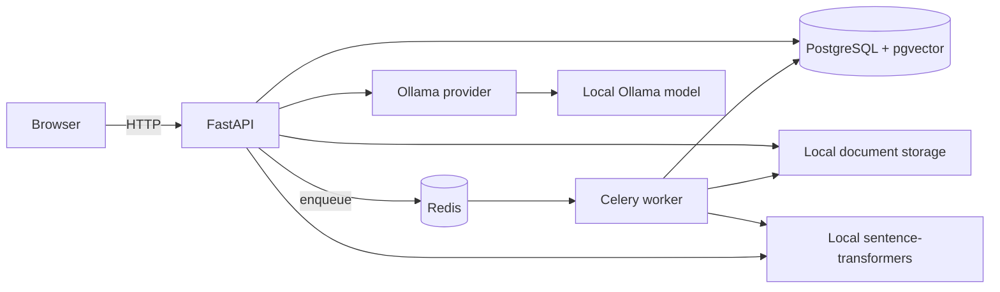

# DocIntel

**Local document intelligence, with every answer tied back to its source.**

DocIntel is a zero-cost, local-first platform for uploading PDF, text, and Markdown files; extracting and indexing their contents; searching semantically; asking evidence-grounded questions; and extracting validated structured data. PostgreSQL with pgvector stores the index, sentence-transformers creates local embeddings, Ollama runs the language model, and Celery handles document processing in the background.

> This repository is the software project, not a hosted service. Uploaded files and model data stay on your computer. You need Docker and enough disk space/RAM for the local models. Ollama model downloads are optional for search, but required for generated answers and extraction.

## Start locally

1. Install Docker Desktop with Compose and Git. Python 3.12+ and Node 20+ are only needed for development outside containers.
2. Copy `.env.example` to `.env` and adjust paths or model names if needed.
3. Start the services: `docker compose up --build`.
4. In another terminal, download the configured Ollama model: `docker compose exec ollama ollama pull llama3.2:3b`.
5. Open <http://localhost:5173>. API docs are at <http://localhost:8000/docs>.

The first embedding-model use downloads `sentence-transformers/all-MiniLM-L6-v2` into the local model cache. Keep that cache and the Ollama volume to avoid repeated downloads. Initial startup can take a few minutes.

## What works

- PDF, TXT, and Markdown uploads with size/type checks, SHA-256 duplicate detection, local file storage, and processing status.
- Page-aware PDF extraction with PyMuPDF; text and Markdown are represented as page 1.
- Configurable, page-preserving chunking and local 384-dimensional embeddings.
- pgvector cosine search that works independently of a language model.
- Local Ollama RAG and Pydantic-validated structured extraction with persisted run history.
- Celery processing with safe reprocessing, failure status, and retry support.
- Query and source records, health checks, API docs, a focused React UI, and an evaluation runner.

## Architecture



The application is split into API routes, domain services, persistence models, and provider adapters. `LLMProvider` is the provider boundary; `OllamaProvider` is the only implementation included. Retrieval remains independently callable and testable without Ollama.

## API overview

| Method | Path | Purpose |
|---|---|---|
| GET | `/health` | Service health |
| POST | `/documents` | Upload and queue a document (202) |
| GET | `/documents` | List documents and statuses |
| GET | `/documents/{id}` | Document metadata and status |
| GET | `/documents/{id}/chunks` | Read extracted passages with page numbers |
| POST | `/search` | Semantic search, independent of the LLM |
| POST | `/ask` | Grounded answer with document/page citations |
| POST | `/documents/{id}/extract` | Extract validated document fields |
| GET | `/queries` | Recent question and response-time history |

The interactive API reference is generated by FastAPI at `/docs`.

## Configuration

All settings have safe local defaults; see `.env.example` for the full list. Important options include database/Redis URLs, local storage and model-cache paths, maximum upload size, chunk size/overlap, retrieval top-k, embedding model, Ollama URL/model, and CORS origins. Do not commit `.env` or documents. No service in this Compose setup calls a paid API.

## Development

Backend (from `backend/`):

```bash
python3.12 -m venv .venv
source .venv/bin/activate
pip install -e '.[dev]'
uvicorn app.main:app --reload
```

Frontend (from `frontend/`):

```bash
npm install
npm run dev
```

The API and worker share the same package. Run database migrations with `alembic upgrade head`. For a full local stack use Compose, which starts PostgreSQL, Redis, API, worker, Ollama, and frontend.

## Evaluation

Place an evaluation set at `evaluation/questions.jsonl` using one JSON object per line: `{"question":"...","expected_document":"manual.pdf","expected_page":3}`. Run `python -m evaluation.run --api http://localhost:8000 --dataset evaluation/questions.jsonl --top-k 5`. It reports Recall@k, citation page accuracy, and average response time from your own corpus. Results are deliberately not prefilled with fabricated measurements; record machine, model, dataset, chunk size, top-k, and date alongside your output.

## Security and limitations

- Documents are untrusted evidence. Prompts explicitly say to ignore instructions inside source text; generated answers are constrained to retrieved passages and can say when evidence is insufficient. This reduces risk but cannot eliminate model errors.
- File names are never used as storage paths. File size, allowed suffix, MIME type, and content signatures are checked; duplicate content hashes are rejected.
- This is a single-user local application. It has no authentication, multi-user isolation, malware scanner, OCR for image-only PDFs, or production hardening. Do not expose its ports to an untrusted network.
- Extraction depends on readable text in the source. Citations are page-level, not exact highlighted coordinates. Scores are cosine similarity, not calibrated confidence.
- Model quality, memory use, and response time depend on your hardware and chosen Ollama model. Search works even while Ollama is stopped.

## Project map

```text
backend/       FastAPI application, domain services, ORM, worker, migration
frontend/      React + TypeScript user interface
evaluation/    Reproducible retrieval/citation measurement runner
docs/          Architecture and implementation notes
```

## License

MIT. See [LICENSE](LICENSE).
